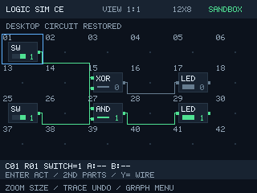

# logic sim CE


A small digital logic sandbox for the **TI-84 Plus CE and TI-84 Plus CE Python**.
Place switches, gates, and lights, connect their inputs, and watch signals change.

**[Download the calculator build](https://github.com/silo555/logic-sim-ce/releases/tag/v0.1.0)** ·
[Install guide](docs/INSTALL.md) · [Controls](#controls) · [Build from source](docs/DEVELOPMENT.md)

**Preview release:** the native program compiles, the shared C code passes local
sanitizer tests, and the desktop preview has been play-tested. Physical calculator
and CEmu testing are still pending. See [testing and limitations](docs/TESTING.md).



*This screenshot comes from the desktop preview, not a physical calculator.*

## What you can build

- Switches, output lights, AND, OR, NOT, NAND, NOR, XOR, XNOR, and buffer gates.
- Thin wires between parts. A wire never occupies a building cell.
- 6×4, 9×6, or 12×8 boards, with up to **96 parts** and automatic scrolling.
- One output feeding multiple inputs, including connections across the scrolled view.
- AND, half-adder, and full-adder examples.
- 16-step undo and a saved circuit that reloads when you start the game.

This version handles **combinational logic**. Feedback loops are rejected; there
are no clocks, latches, or flip-flops yet. Wire crossings are not junctions.

## Quick start

1. Download **LogicSimCE-v0.1.0-calculator.zip** from the
   [release page](https://github.com/silo555/logic-sim-ce/releases/tag/v0.1.0) and unzip it.
2. Send **LOGICCE.8xp** to **Archive** with TI Connect CE.
3. Open your working **Cesium** launcher, select **LOGICCE**, and press ENTER.

You need a working native-program launcher and the CE C runtime libraries.
Modern CE OS versions require an appropriate launcher setup. Follow the
[install guide](docs/INSTALL.md) for requirements and official dependency links.
The monochrome TI-84 Plus and TI-84 Evo are not supported.

The first launch opens a half adder. Toggle the switches in cells **01** and
**13**. Light **11** shows sum; light **17** shows carry. With both switches on,
sum is 0 and carry is 1. A saved circuit replaces this demo on later launches.

## Controls

| Key | Action |
| --- | --- |
| Arrows | Move; automatically scroll at the screen edge |
| ENTER | Place a part on an empty cell; toggle a switch |
| 2nd | Open parts or change the selected part |
| Y= | Start a wire from the selected part; press again to cancel |
| WINDOW | Select destination input A or B |
| ENTER while wiring | Connect the source to the selected input |
| ZOOM | Choose sandbox size |
| DEL | Remove a part; while wiring, disconnect the chosen input |
| TRACE | Undo up to 16 changes |
| GRAPH / MODE | Menu, save, demos, help, and quit |
| CLEAR | Cancel a wire or go back |

To wire two parts: select the source → Y= → move to the target → choose A/B
with WINDOW → ENTER. Single-input parts always use A. An output can feed many
parts; connecting to an input replaces that input's previous wire.

**Green = 1. Gray = 0. Amber `?` = unknown or unconnected.**

Expand with ZOOM. Parts keep their positions and connections, and the view
follows the cursor. Shrinking is refused if it would cut off a part. TRACE also
undoes resizing, loading a demo, and clearing the board.

## Saving

Use **GRAPH → SAVE CIRCUIT** or **SAVE AND QUIT**. There is one saved circuit.
Undo history lasts for the current session only.

The game alternates two small AppVars, `LGSAVE0` and `LGSAVE1`, with CRC checks.
Include both in backups. It reads older 24-cell saves and upgrades them on the
next save. Older program builds cannot read the expanded save format.

## Desktop preview

On macOS or Linux, with Python 3 and a C compiler installed:

```sh
python3 preview/run.py
```

Open the localhost URL it prints. The browser buttons map to calculator keys.
Keyboard shortcuts: arrows, ENTER, Space (parts), W (wire), P (input), Z (size),
Delete (erase), U (undo), M (menu), and Escape (back).

The preview runs the **same C simulation, UI, and pixel renderer** as the
calculator build. It uses desktop storage and does not emulate the TI OS.
Native Windows preview support has not been tested; use Linux/WSL if needed.

## Name and icon in Cesium

The program contains its own 16×16 pixel icon and the spaced description
**logic sim CE**. Cesium's program list still shows **LOGICCE**, because TI
variable names cannot contain spaces. The spaced name appears in the selected
program's description. No separate icon file needs to go on the calculator.

## Development and feedback

- [Build, test, and project layout](docs/DEVELOPMENT.md)
- [Verification status and limitations](docs/TESTING.md)
- [Changelog](CHANGELOG.md)
- [Report a bug](https://github.com/silo555/logic-sim-ce/issues/new?template=bug_report.md)
- [Contributing](CONTRIBUTING.md)

Source and original pixel graphics are under the [MIT license](LICENSE).
CEdev, Cesium, and runtime libraries retain their upstream licenses and are
not bundled in this repository. This project is not affiliated with Texas Instruments.
